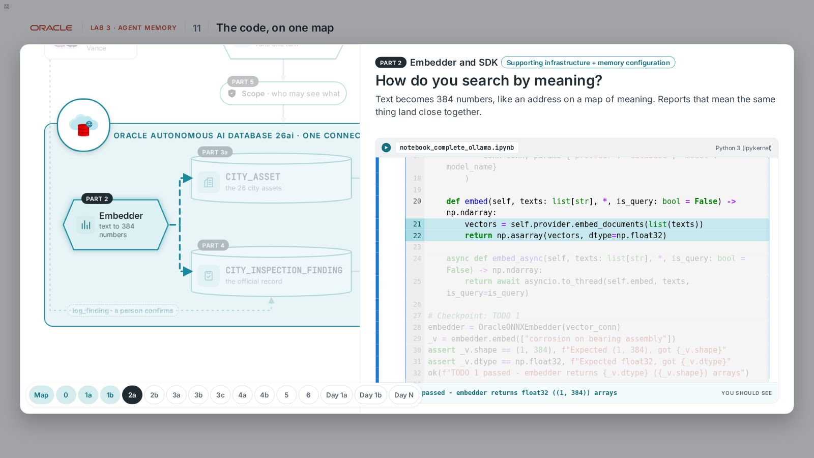
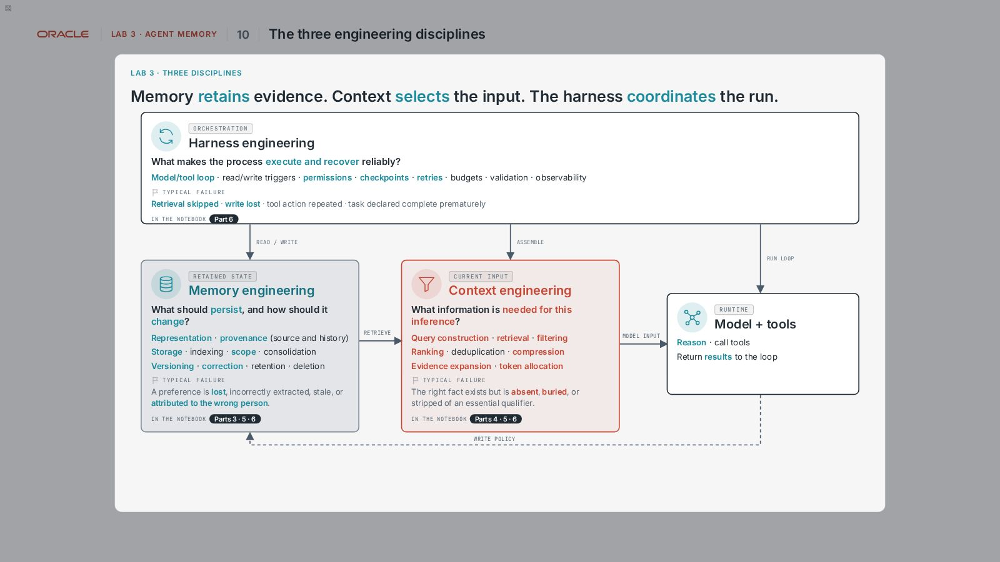
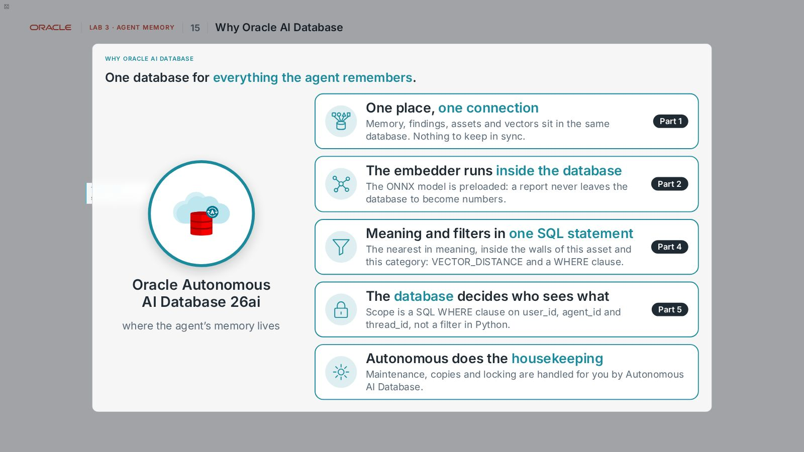
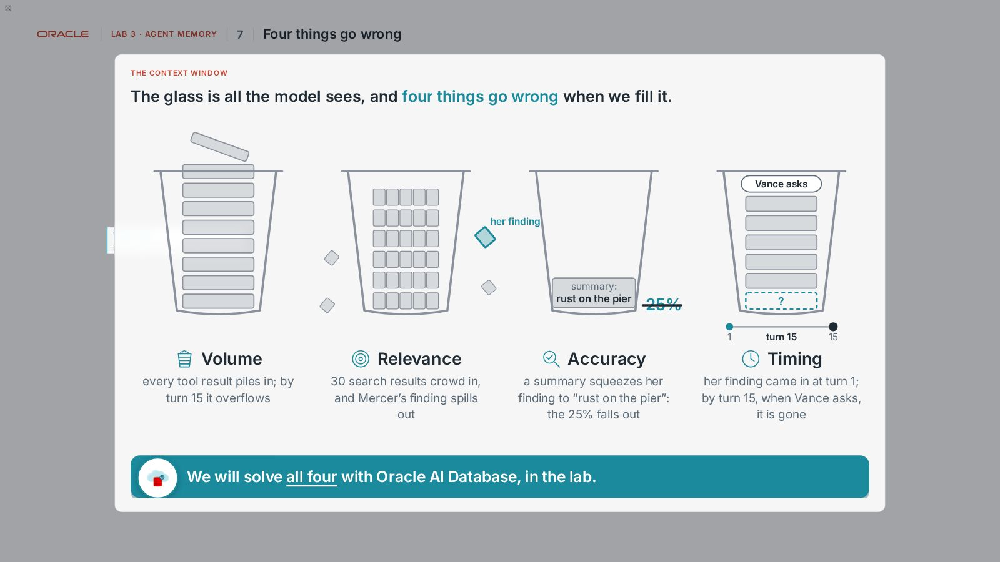
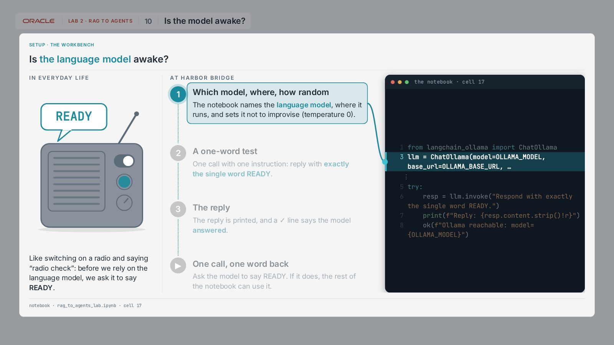
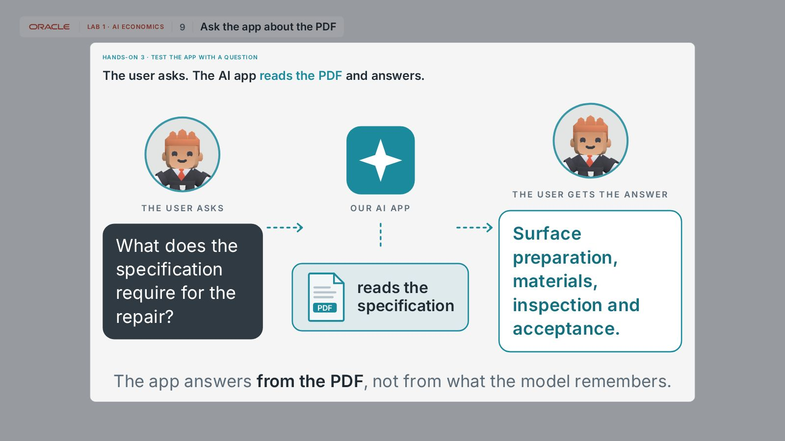
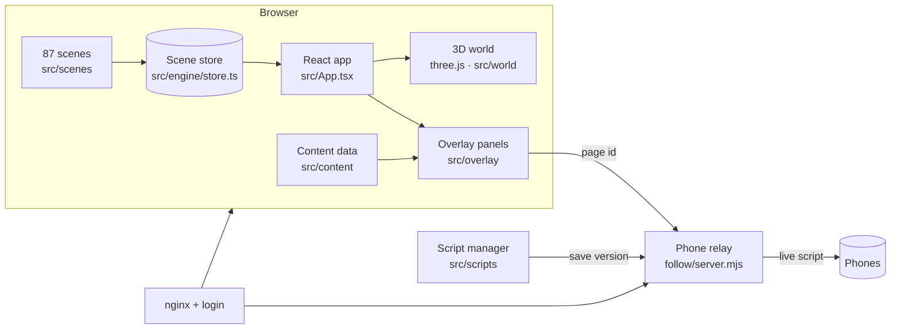

<div align="center">

# 🌆 CityOps Live

**A click-through 3D smart city that teaches engineers how AI really works.**<br/>
Offline · deterministic · no AI at runtime · built for a live stage.




<sub>Lab 3 · "The code, on one map": each click flies the map to one part of the notebook while the real notebook cell lights up beside it.<br/>
(Screenshots here come from a machine without a GPU, so the 3D city behind the panels is not drawn; on a normal computer the panels sit over the Bangkok scene.)</sub>

</div>

---

## What is this?

CityOps Live is the stage show for **AI Experience Live 2026** (Oracle LiveLabs, Bangkok, 12 Nov 2026). One engineer, **Mercer**, finds rust on **Harbor Bridge** and records it. Weeks later a second engineer, **Vance**, stands at the same rust. The three workshops follow how an AI system helps them, step by step:

| Part | Pages | The story |
|---|---:|---|
| **Introduction** | 7 | Bangkok from above, the bridge, the three labs |
| **Lab 1 · AI Economics** | 23 | One assistant that is useful, affordable and safe: your data in a vector store, a semantic store, model routing, guardrails |
| **Lab 2 · RAG to Agents** | 38 | From looking one thing up to an agent that decides what to look up across documents, tables, readings and connections |
| **Lab 3 · Agent Memory** | 19 | An agent that remembers: what the first inspector learned reaches the second, with Oracle AI Database underneath |

**87 pages in all**, every one reachable by address (`#scene=3.6m`). The presenter walks them with a clicker; the audience follows the script on their phones.

Everything is **deterministic**: no language model runs while the show plays. The data on screen is exactly what the workshop notebooks print.

## Gallery

| | |
|---|---|
| <br/><sub>Lab 3 · the three engineering disciplines</sub> | <br/><sub>Lab 3 · why Oracle AI Database</sub> |
| <br/><sub>Lab 3 · four things go wrong with the context window</sub> | <br/><sub>Lab 2 · a notebook page: picture, steps, the key lines</sub> |
| <br/><sub>Lab 1 · the app reads the PDF and answers</sub> | |

## ✨ What it can do

- 🎬 **Click-through story** with cinematic camera moves between five places (the city, the Ops centre, the bridge, two piers). Every move is checked by tests so the camera never shows the sky or the edge of the map.
- 📓 **The real notebooks on screen**: Lab 3's code map shows the owner's actual run notebook, line numbers and results included, never retyped.
- 📱 **Phone follow**: the audience scans a QR code and reads the presenter's script live, in English or Thai.
- ✍️ **Script manager**: colleagues edit the English and Thai script of any page, see every version, comment in threads. Saves go live to phones at once.
- 🎛️ **Presenter tools**: jump menu, notes, presentation mode for a clicker, camera mode (save your own camera angles), traffic mode (draw car and boat routes), settings for sky, resolution and language.
- 🌐 **Runs anywhere**: one static build, or the live setup the workshop used (Vite dev server, nginx login, the phone relay).

---

## 🚀 Quick start

```bash
git clone https://github.com/markerxz/aiel2026-cityops.git
cd aiel2026-cityops
npm ci
npm run dev          # → http://localhost:5174
```

You need **Node 20 or newer** (developed on Node 26) and about 600 MB of disk (the repo carries the 3D city, about 130 MB). A computer with a GPU shows the 3D city; without one the panels still work.

**Keys**

| Key | Does |
|---|---|
| `→` / `←` | next / back (every click is a page or a build step) |
| `J` | jump menu (all pages as pictures) |
| `N` | presenter notes |
| `L` | language, English / Thai |
| `C` | camera mode (move the camera, save an angle) |
| `Page Down` / `Page Up`, `B`, `F5` | for a clicker: Settings › Presentation mode |

Any page opens by address, for example `http://localhost:5174/#scene=3.6m` (the Lab 3 code map).

### ✅ Check that your setup is healthy

One command proves a fresh checkout works end to end: install, type check, every test, a production build, serving that build, the dev server and the phone relay. No browser or GPU is needed.

```bash
bash tools/verify-setup.sh          # 3 to 5 minutes
SKIP_INSTALL=1 bash tools/verify-setup.sh   # when node_modules already exists
```

It ends with `All checks passed.` Last verified on a clean clone of this repository: Oracle Linux 9 (aarch64), Node 26, 391 tests passing.

---

## 🧭 Deploy it

Three ways, from simplest to the one the workshop ran. Full steps, config files and the checks are in **[`deploy/README.md`](deploy/README.md)**.

| | How | Use it when |
|---|---|---|
| **A · Run on your laptop** | `npm run dev` | rehearsing, editing, presenting from one machine |
| **B · Static build behind nginx** | `bash tools/deploy-static.sh /var/www/cityops` + `deploy/nginx-cityops.conf` + `deploy/cityops-follow.service` | a shared address with a login for the presenter and open phone pages (recommended for a new host) |
| **C · The workshop setup** | Vite dev server as the live site, nginx login, relay, git hook (`tools/vm-setup.sh`, `deploy/cityops-dev.service`) | you want Camera mode and Traffic mode to **save** into the repo from the live site |

A quick taste of B (the address is baked into the build; the default is `/aiexperiencelive2026/`):

```bash
bash tools/deploy-static.sh /var/www/cityops        # builds and copies to /var/www/cityops/aiexperiencelive2026/
sed "s#__WEB_ROOT__#/var/www/cityops#; s#__HTPASSWD__#/etc/nginx/cityops.htpasswd#" \
    deploy/nginx-cityops.conf | sudo tee /etc/nginx/snippets/cityops.conf   # then include it in your server {}
sudo cp deploy/cityops-follow.service /etc/systemd/system/  # edit __USER__, __APP_DIR__, __NODE__
sudo systemctl daemon-reload && sudo systemctl enable --now cityops-follow
```

---

## 🏗️ How it fits together



A **scene** (`src/scenes`) says where the camera goes (a *shot*), what the 3D world shows, which **overlay panel** appears (`src/overlay`) and what the presenter says. The scene store walks the list; the world and the overlay react to the current scene.

### Project layout

```
src/
  scenes/      the 87 pages: chapter0 (intro), lab1, chapter1 (Lab 2), chapter2 (Lab 3), scripts, sections
  overlay/     the panels on top of the 3D view: concepts/ (one file per page family), jupyter/, handsOn/, JumpMenu, Settings…
  world/       the 3D city: shots.ts (camera places), Bangkok model, bridge, cars, boats, sky stages, lights
  engine/      scene store, address hash, keys, presentation mode, phone follow client, camera and traffic stores
  content/     data the pages show: notebooks (real .ipynb as JSON), Thai scripts, code-map steps, traffic, saved camera angles
  scripts/     the script manager (colleagues edit scripts)
follow/        the phone relay (zero-dependency Node server) and the phone page
tests/         about 390 tests (vitest): scenes, overlays, camera frames and motion, scripts, relay
tools/         verify-setup, deploy-static, capture previews, export scripts, VM setup
deploy/        nginx and systemd templates
docs/          hand-off notes, the Lab 3 audit, the presenter script
public/        models (the city, characters), thumbnails, service worker
```

### Where to change what

| I want to… | Look at |
|---|---|
| change what a page **says or draws** | `src/overlay/concepts/` (find the page's `overlay` key in `src/scenes/*.ts`, then `register.ts`) |
| **add, remove, reorder** a page | `src/scenes/chapter0.ts`, `lab1.ts`, `chapter1.ts`, `chapter2.ts` (and `sections.ts` for the jump menu) |
| make a page build up **one part per click** | `PAGE_STEPS` in `src/engine/presentation.ts`, and the overlay reads the step |
| change the **camera** | `src/world/shots.ts`; saved angles are `src/content/cameraOverrides.json` (the owner's, ask first) |
| change the **presenter script** | `src/scenes/script.ts` (English), `src/content/scriptTh.ts` (Thai), or the script manager |
| change the **Lab 3 code map** | `src/content/lab3Map.ts` (steps), `src/overlay/concepts/CodeMap.tsx` |
| change **notebook data** | `src/content/notebooks/*.json` (never edit the notebook text: it is the owner's run) |
| change the **3D world** | `src/world/*.tsx` |

More detail, step by step, lives in the skill below.

---

## 🧪 Tests

```bash
npx vitest run          # about 390 tests, about 50 seconds
npx tsc --noEmit        # type check
npm run build           # type check + production build into dist/
```

The tests do more than check code: they check **the story**. Every page has a registered panel, every Lab 3 page has a Thai script; every camera frame stays on the map; every camera move stays calm; every notebook line the code map shows exists in the notebook.

---

## 🤖 For AI coding agents and new teammates

This repository is meant to be picked up by an agent (Codex, Claude Code, others) or a person on day one.

- **[`AGENTS.md`](AGENTS.md)** is the short entry point: how to install, run, test, deploy, and the rules that never change.
- **The skill `cityops-live`** (`.claude/skills/cityops-live/`, also linked at `.agents/skills/cityops-live/`) knows the whole system: where everything is, and a recipe for each kind of change (add a page, change a script, change the camera, add a build step, deploy). Start with its `SKILL.md`.
- **[`CLAUDE.md`](CLAUDE.md)** is the project's long memory: the owner's rules and decisions, page by page.
- **[`docs/`](docs/)** holds the hand-off notes and the Lab 3 audit against the real notebook.

## 📜 Rules that never change

The short version (the full list is in `CLAUDE.md` and the skill):

- The Jupyter notebooks are **never modified**; names on screen are exactly what the notebooks print.
- The agent is **"the AI agent"**, never "copilot"; the model is never named on screen.
- No pier numbers on screen ("the crack", "the rust"). Never write Kirkland, MEA, MWA or BMA.
- Colours: teal for data, Oracle Red for the one thing to look at (never more than one red element), cool greys for the rest.
- **Offline**: no runtime network calls (the phone follow feature is the only optional exception).
- Never judge a page from a wide shot: look at it at full size.

## 🩺 Troubleshooting

| Problem | Fix |
|---|---|
| Port 5174 is busy | `npm run dev` uses a fixed port on purpose; stop the other process, or run `npx vite --port 5180` |
| Black screen, no city | The browser has no WebGL (headless, remote desktop). Panels still work; use a machine with a GPU |
| Changes do not show after a deploy | The map is cached by a service worker: hard-reload, or clear site data |
| Phone says "code not found" | The session ended (stopped, or 90 minutes without a page change) or the code is old; start sharing again. The presenter's page repeats its page every 5 minutes to keep a session alive |
| `npm ci` fails | You need Node 20 or newer (`node -v`) and network access to the npm registry |
| The build says the base is wrong | The address is baked in at build time: `CITYOPS_BASE=/your/path/ npm run build` (or `tools/deploy-static.sh`) |

## 🙏 Credits and licences

- Streets, rail and the river centreline: OpenStreetMap © contributors (ODbL), fetched with `tools/build_roads.py`.
- The central city is "Bangkok" by TerraMesh ([Sketchfab](https://sketchfab.com/3d-models/bangkok-52642605182e40709802bc030ce05174)), **CC-BY-4.0**, with textures and terrain stripped and blocks recoloured.
- People, city kits and furniture: Kenney (**CC0**).
- Fonts: Inter, Noto Sans Thai, JetBrains Mono (open fonts, bundled).
- Oracle names, logos and LiveLabs screenshots belong to Oracle.
- This repository has **no licence file yet**: ask the owner before reusing the code or content.

<div align="center"><sub>Made for AI Experience Live 2026 · Oracle Cloud Engineering Thailand</sub></div>
